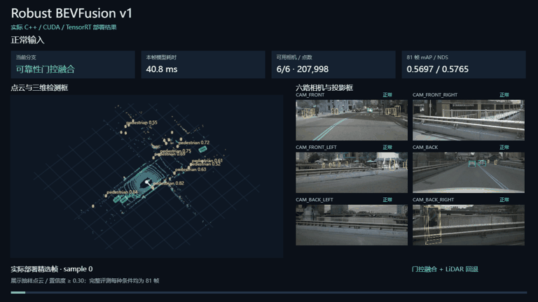
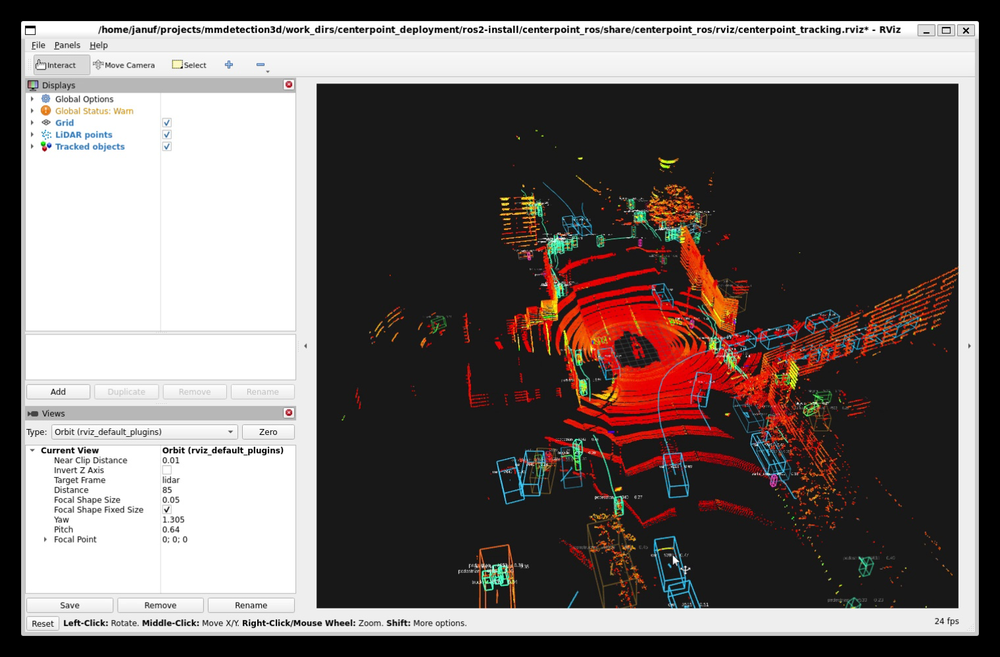

# Robust 3D Perception Systems

[](https://github.com/Fxyuh/robust-3d-perception-systems/actions/workflows/portfolio-ci.yml)
[](LICENSE)

A portfolio project for camera/LiDAR 3D perception. The BEVFusion milestone
covers native C++/CUDA/TensorRT inference, a ROS2 adapter and reproducible
mini-val evaluation. The CenterPoint milestone covers LiDAR detection,
visualization and multi-object tracking.

## Robust BEVFusion v1: gated fusion + LiDAR fallback

[](projects/BEVFusion/deploy/native_cpp/v1/docs/assets/bevfusion_v1_demo.mp4)

[Watch MP4](projects/BEVFusion/deploy/native_cpp/v1/docs/assets/bevfusion_v1_demo.mp4) · [Download interactive demo ZIP](projects/BEVFusion/deploy/native_cpp/v1/docs/demo/bevfusion_v1_interactive.zip?raw=true) · [Download single HTML](projects/BEVFusion/deploy/native_cpp/v1/docs/demo/bevfusion_v1_interactive.html?raw=true)

The GIF/video show actual saved native predictions. To interact, download the ZIP,
extract it and double-click the HTML file; no server/model is required. GitHub
does not execute HTML in the repository view. The compact demo has 12 selected
frames per condition; each reported metric uses all 81 validation frames.

The deployed v1 uses the frozen learned reliability gate when cameras remain
available and the official LiDAR-only expert when all six cameras fail. Both
experts execute through C++/CUDA/TensorRT in a ROS2 node. Six TensorRT engines
and two CUDA sparse models are exported from the exact frozen weight hashes.

| Input condition (81 mini-val frames, seed 0) | PyTorch v1 mAP | Native v1 mAP / NDS | Native model P50 / P95 |
| --- | ---: | ---: | ---: |
| Normal | 0.5680 | 0.5697 / 0.5765 | 43.7 / 45.5 ms |
| 3 cameras off + 75% LiDAR dropout | 0.4669 | 0.4628 / 0.5056 | 32.9 / 34.1 ms |
| 6 cameras off + 75% LiDAR dropout | 0.4361 | 0.4327 / 0.4953 | 13.1 / 13.9 ms |

The historical Plain reference is 0.3630 mAP under the last condition. The
PyTorch v1 gain is +0.0731; the native v1 comparison is +0.0697 against that
historical reference. Full-camera-failure gain comes from the LiDAR-only
fallback. Training protocols/backend differ, so this is not a controlled
architecture ablation or a gate-only gain.

The local replay shows real native predictions: six camera views, projected
boxes, a rotatable 3D point cloud, input health, routing and timing. Raw sensor
topic synchronization is outside the current node interface.

See the [v1 reproduction and viewer guide](projects/BEVFusion/deploy/native_cpp/v1/README.md),
[exact results](projects/BEVFusion/deploy/native_cpp/v1/results/) and
[attribution](projects/BEVFusion/deploy/native_cpp/THIRD_PARTY_NOTICES.md).
The [earlier epoch-4 deployment](projects/BEVFusion/deploy/native_cpp/README.md)
is retained separately; its timing is not attributed to v1.

## CenterPoint LiDAR deployment

[](projects/CenterPointDeployment/docs/assets/centerpoint_ros2_tracking_public.mp4)

## CenterPoint implementation

- Deterministic C++ voxelization and CUDA pillar feature encoding/scatter.
- Mixed-FP16 TensorRT inference with native CenterPoint decoding and circle NMS.
- Numerical validation from intermediate tensors through final 3D boxes.
- ROS 2 messages, replay nodes, RViz visualization and launch workflows.
- Global-frame Kalman tracking with class-wise Hungarian assignment.
- Full nuScenes mini-val detection/tracking evaluation, latency percentiles and
  process-level GPU-memory measurement.

## CenterPoint verified results

| Result | Measured value | Scope |
|---|---:|---|
| TensorRT C++ detection | 0.412667 mAP / 0.480336 NDS | All 81 mini-val frames |
| PyTorch detection baseline | 0.410953 mAP / 0.482046 NDS | Same checkpoint and protocol |
| Detector latency | 14.996 ms P50 / 16.024 ms P95 | 81 mini-val frames |
| Deployment GPU memory | 693.91 MiB NVML peak delta | Includes TensorRT allocations |
| Multi-object tracking | 0.655 AMOTA / 0.568 mAMOTP | Official mini-val evaluation |

These are nuScenes `v1.0-mini` results, not full nuScenes validation results.

## Repository map

```text
configs/centerpoint/                       mini dataset configuration overlay
projects/CenterPointDeployment/cpp/       C++/CUDA/TensorRT detector
projects/CenterPointDeployment/ros2/      ROS 2 integration and tracker
projects/CenterPointDeployment/tools/     export, validation and evaluation tools
projects/CenterPointDeployment/results/   machine-readable benchmark summaries
projects/BEVFusion/deploy/native_cpp/      native fusion deployment and reproduction
```

See the [implementation and reproduction guide](projects/CenterPointDeployment/README.md),
[resume-ready project summary](projects/CenterPointDeployment/docs/RESUME_PROJECT_CN.md)
and [third-party attribution](projects/CenterPointDeployment/THIRD_PARTY_NOTICES.md).

## Integration with MMDetection3D

This is a project-specific integration layer rather than a vendored copy of
MMDetection3D. Use it with a separate MMDetection3D v1.4.0 checkout. The
existing tools expect the project directory and mini configuration to be
visible from that checkout:

```bash
export PORTFOLIO_ROOT=/absolute/path/to/robust-3d-perception-systems
export MMDET3D_ROOT=/absolute/path/to/mmdetection3d

ln -s "${PORTFOLIO_ROOT}/projects/CenterPointDeployment" \
  "${MMDET3D_ROOT}/projects/CenterPointDeployment"
ln -s "${PORTFOLIO_ROOT}/configs/centerpoint/centerpoint_pillar02_nuscenes_mini_1gpu.py" \
  "${MMDET3D_ROOT}/configs/centerpoint/centerpoint_pillar02_nuscenes_mini_1gpu.py"
```

Then follow the reproduction guide from `${MMDET3D_ROOT}`. Dataset files,
checkpoints, exported ONNX graphs and TensorRT engines are intentionally not
redistributed.

## Scope and attribution

CenterPoint, BEVFusion, MMDetection3D, official configurations/pretrained models
and NVIDIA CUDA-BEVFusion are upstream work. This repository covers checkpoint
export and interface adaptation, deployment/reproduction tooling, ROS2 adapters,
tracking implementation and systems evaluation. See the
[third-party notices](projects/CenterPointDeployment/THIRD_PARTY_NOTICES.md)
for the complete dependency scope.
