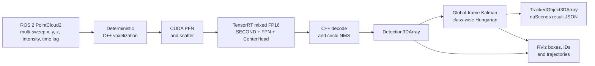

# CenterPoint TensorRT + ROS 2 Deployment

A production-oriented LiDAR 3D perception pipeline built from an MMDetection3D
CenterPoint checkpoint. It replaces the PyTorch inference path with a verified
C++/CUDA/TensorRT implementation, exposes ROS 2 interfaces and adds an
evaluated multi-object tracker. The trained network and checkpoint are not
modified.

The CenterPoint architecture, official MMDetection3D configuration and
pretrained checkpoint are upstream work. This project's contribution is the
deployment boundary, numerical validation, ROS 2 integration, tracking and
systems evaluation described below. See
[third-party scope and attribution](THIRD_PARTY_NOTICES.md).

This standalone repository contains only the project-specific integration
layer. Before running the commands below, link its `projects/CenterPointDeployment`
directory and mini configuration into an MMDetection3D v1.4.0 checkout as
described in the repository-level README.

## Highlights

| Result | Measured value | Evaluation scope |
|---|---:|---|
| End-to-end point cloud to 3D boxes | **12.17 ms / 82.16 FPS** | 50 steady-state runs, RTX 5070 Ti |
| Official detection accuracy | **0.412667 mAP / 0.480336 NDS** | C++ TensorRT, all 81 nuScenes `v1.0-mini` validation frames |
| Full mini-val detector latency | **14.996 ms P50 / 16.024 ms P95** | Point tensor to decoded boxes, 81 frames |
| Total deployment GPU memory | **693.91 MiB NVML peak delta** | Before CUDA initialization through all 81 frames |
| PyTorch-to-deployment box parity | **0.127 mm mean / 0.591 mm max** center error | One real nuScenes mini sample, score >= 0.2 |
| Official tracking accuracy | **0.655 AMOTA / 0.568 m AMOTP / 58 IDS** | All 81 nuScenes `v1.0-mini` validation frames |
| Optimized tracking latency | **2.973 ms**, 37.1% below global Hungarian | Frame-weighted mean over both mini-val scenes |

The implementation work includes deterministic C++ voxelization, CUDA pillar
feature encoding and scatter, precision-controlled TensorRT inference, native
C++ CenterPoint decoding and circle NMS, ROS 2 replay/visualization, global-frame
Kalman tracking and class-wise Hungarian assignment. Intermediate tensors,
decoded boxes and official tracking metrics are checked against their reference
implementations rather than judged only by visualization.



The 82.16 FPS result is a single-process steady-state benchmark on one real
sample. The separate 81-frame result reports the cross-frame distribution.
Detection and tracking accuracy are reported on nuScenes mini validation only;
full nuScenes validation has not been evaluated.

## Quick ROS 2 demo

[](docs/assets/centerpoint_ros2_tracking_public.mp4)

Click the preview to open the 14.7-second recorded demo.

From the linked MMDetection3D repository root, launch the portfolio demo under
WSL X11:

```bash
bash projects/CenterPointDeployment/tools/run_portfolio_demo.sh
```

It replays the 40-frame `scene-0103` sequence at the native 2 Hz sample rate
and loops without writing a result file. RViz shows the LiDAR cloud, 3D boxes,
stable track IDs and recent trajectories. Press `Ctrl+C` in the terminal to
stop. Pass `scene-0916` as the first argument to use the other mini-val scene.

## Deployment boundary

The first deployment boundary is:

```text
ROS 2 PointCloud2 (x, y, z, intensity, optional time_lag)
  -> deterministic C++ voxelization
  -> CUDA PillarFeatureNet / PointPillarsScatter
  -> [1, 64, 512, 512] pseudo image
  -> C++ TensorRT runtime: mixed FP16 SECOND / SECONDFPN / CenterHead
  -> 36 raw task tensors
  -> C++ CenterPoint decode / circle NMS
  -> Detection3DArray + RViz MarkerArray
```

The inference executable has no Python or PyTorch runtime dependency. It is an
end-to-end C++/CUDA/TensorRT path starting from the five-channel, temporally
aligned multi-sweep point tensor. The ROS 2 demo republishes a tensor exported
by the official nuScenes loader for deterministic parity testing. Live sensor
drivers, ego-motion compensation and multi-sweep assembly remain outside the
current deployment boundary.

## Environment isolation

The existing `mmdet3d-centerpoint` Conda environment must remain unchanged.
Create a small virtual environment that can read its packages but owns the
new ONNX and TensorRT dependencies. Set these paths for the local machine:

```bash
export MMDET3D_ROOT=/absolute/path/to/mmdetection3d
export MMDET3D_ENV=/absolute/path/to/mmdet3d-centerpoint
export CPD_VENV=/absolute/path/to/centerpoint-deploy
cd "${MMDET3D_ROOT}"

"${MMDET3D_ENV}/bin/python" -m venv \
  --system-site-packages "${CPD_VENV}"
"${CPD_VENV}/bin/pip" install \
  -r projects/CenterPointDeployment/requirements-deploy.txt
```

## Export and validate

Run from the MMDetection3D repository root:

```bash
"${CPD_VENV}/bin/python" \
  projects/CenterPointDeployment/tools/export_dense_onnx.py --precision fp32

"${CPD_VENV}/bin/python" \
  projects/CenterPointDeployment/tools/autocast_onnx.py

"${CPD_VENV}/bin/python" \
  projects/CenterPointDeployment/tools/build_and_validate_tensorrt.py \
  --onnx work_dirs/centerpoint_deployment/onnx/centerpoint_dense_mixed_fp16_deep.onnx \
  --reference work_dirs/centerpoint_deployment/onnx/reference_sample_fp32.npz

"${CPD_VENV}/bin/python" \
  projects/CenterPointDeployment/tools/validate_decoded_predictions.py
```

Generated ONNX, TensorRT engines and reference arrays are written under
`work_dirs/centerpoint_deployment/` and must not be committed.

TensorRT 11 obtains FP16 types directly from the exported ONNX graph; no
deprecated global FP16 builder flag is used. The validation report records
TensorRT version, GPU, dense-network latency,
peak allocated memory and per-output numerical differences from PyTorch.

The current mixed-precision policy keeps the first two backbone blocks, shared
convolution and task heads in FP32. The deepest backbone block and neck use
FP16.
This policy was selected from real-sample parity tests; the rejected all-FP16
candidate is not used as the deployment result.

## Verified result on RTX 5070 Ti

The current milestone was validated with TensorRT 11.2.1.2 and one real
nuScenes mini validation sample:

| Dense network | Mean latency | Relative speed |
|---|---:|---:|
| Strict FP32 | 5.11 ms | 1.00x |
| Mixed FP16 | 4.70 ms | 1.09x |

At score thresholds 0.2 and 0.3, the decoded PyTorch and TensorRT predictions
had identical detection counts, class counts and 100% assignment coverage. At
0.2, matched box centers differed by 0.136 mm on average and 0.733 mm at most.

These numbers cover only SECOND, SECONDFPN and CenterHead. They must not be
reported as end-to-end point-cloud latency; voxelization, pillar encoding,
scatter, decoding and NMS are not included yet.

## C++/CUDA pillar preprocessing

Export one real validation sample and its folded PFN weights:

```bash
"${CPD_VENV}/bin/python" \
  projects/CenterPointDeployment/tools/export_preprocess_reference.py
```

Build for the RTX 5070 Ti (SM 12.0) using the existing CUDA 12.8 toolkit:

```bash
bash projects/CenterPointDeployment/tools/fetch_tensorrt_headers.sh
cmake -S projects/CenterPointDeployment/cpp \
  -B work_dirs/centerpoint_deployment/cpp-build \
  -DCMAKE_BUILD_TYPE=Release \
  -DCMAKE_CUDA_COMPILER="${MMDET3D_ENV}/bin/nvcc" \
  -DCUDAToolkit_ROOT="${MMDET3D_ENV}" \
  -DTENSORRT_LIBRARY="${CPD_VENV}/lib/python3.10/site-packages/tensorrt_libs/libnvinfer.so.11" \
  -DCMAKE_CUDA_ARCHITECTURES=120
cmake --build work_dirs/centerpoint_deployment/cpp-build --parallel 4
./work_dirs/centerpoint_deployment/cpp-build/centerpoint_preprocess
```

On sample 0 (219,288 multi-sweep points), the C++ implementation reproduced
all 5,268 voxel coordinates, point counts and voxel contents exactly. Against
the PyTorch PFN/scatter reference, the pseudo image had maximum absolute error
`1.0341e-4` and mean absolute error `3e-8`. The measured stage times were 5.16
ms for deterministic CPU voxelization and 0.103 ms for CUDA PFN plus scatter.

Run the generated pseudo image through TensorRT and then the official decode:

```bash
"${CPD_VENV}/bin/python" \
  projects/CenterPointDeployment/tools/validate_cpp_tensorrt.py
"${CPD_VENV}/bin/python" \
  projects/CenterPointDeployment/tools/validate_decoded_predictions.py \
  --candidate work_dirs/centerpoint_deployment/tensorrt/centerpoint_cpp_preprocess_mixed_fp16.outputs.npz \
  --report work_dirs/centerpoint_deployment/tensorrt/decoded_parity_cpp_preprocess_sample0.json
```

At score threshold 0.2, this chain produced 66 PyTorch and 66 deployment
detections with identical per-class counts and 100% assignment coverage. Mean
center error was 0.127 mm and maximum center error was 0.591 mm. Stage timings
come from separate validation processes and are not presented as end-to-end
latency; the single-process benchmark in the next section covers that boundary.

## End-to-end C++ inference

The TensorRT C++ headers are fetched from NVIDIA's official TensorRT repository
at commit `c93b7d4893184af4882f9f1862e13a5c64b8677d`, whose
`NvInferVersion.h` identifies version 11.2.1.2. They remain under the ignored
`work_dirs` dependency directory; the executable links the already installed
pip runtime library rather than replacing the environment.

Run the full single-process inference benchmark:

```bash
./work_dirs/centerpoint_deployment/cpp-build/centerpoint_infer \
  --warmup 20 --iterations 50

"${CPD_VENV}/bin/python" \
  projects/CenterPointDeployment/tools/validate_cpp_detections.py
```

For sample 0 on the RTX 5070 Ti, 50 steady-state iterations gave:

| Stage | Mean latency |
|---|---:|
| Deterministic C++ voxelization | 3.65 ms |
| H2D + CUDA PFN/scatter + TensorRT + D2H | 6.82 ms |
| C++ decode + circle NMS | 1.70 ms |
| Full pipeline | 12.17 ms |

Full-pipeline P50 was 12.10 ms, P95 was 13.45 ms and throughput was 82.16
FPS. The explicitly allocated CUDA input/output buffers used 94.17 MiB; this
number excludes TensorRT's internal context and engine allocations.

At score threshold 0.2, the final C++ output and PyTorch reference both had 66
detections, identical per-class counts and 100% assignment coverage. Mean
center error was 0.127 mm and maximum center error was 0.591 mm.

## Full mini-val C++ detection evaluation

Run the C++/TensorRT detector on both mini-val scenes and then call the official
nuScenes evaluator:

```bash
./work_dirs/centerpoint_deployment/cpp-build/centerpoint_dataset_eval

"${CPD_VENV}/bin/python" \
  projects/CenterPointDeployment/tools/evaluate_cpp_detection.py
```

The result contains all 81 unique `mini_val` sample tokens and 16,026 decoded
boxes before the official range and bike-rack filters. It uses the same model
checkpoint and nuScenes evaluation protocol as the existing PyTorch baseline:

| Backend | mAP | NDS | Difference from PyTorch |
|---|---:|---:|---:|
| MMDetection3D / PyTorch | 0.410953 | 0.482046 | - |
| C++ / CUDA / TensorRT mixed FP16 | 0.412667 | 0.480336 | +0.001714 mAP / -0.001710 NDS |

Machine-readable aggregate results and per-class AP values are provided in
[`detection_metrics.json`](results/detection_metrics.json) and
[`detection_backend_comparison.csv`](results/detection_backend_comparison.csv).

Across the 81 frames, point-tensor-to-box latency was 15.196 ms mean, 14.996 ms
P50 and 16.024 ms P95. Point-file loading was measured separately at 5.047 ms
mean, 4.990 ms P50 and 5.737 ms P95. The run records every frame in
`frame_timings.csv`; the complete measured sequence wall time was 1,642.894 ms.

NVML was sampled every 1 ms from before CUDA initialization through completion
of all inference frames. Device used memory rose from 3,115.52 MiB to a
3,809.43 MiB peak, a 693.91 MiB delta that includes the CUDA context, TensorRT
engine/context/workspace and 94.17 MiB of explicit CUDA buffers. WSL2 does not
expose per-process used memory through NVML on this machine, so this value is a
device baseline-to-peak measurement and assumes no concurrent GPU workload
changed during the run; it is not presented as native per-PID accounting.

## ROS 2 / RViz integration

ROS 2 Humble is installed in the Ubuntu system environment; the existing
MMDetection3D Conda environment remains unchanged. Build from the repository
root:

```bash
source /opt/ros/humble/setup.bash
colcon --log-base work_dirs/centerpoint_deployment/ros2-log build \
  --base-paths projects/CenterPointDeployment/ros2 \
  --build-base work_dirs/centerpoint_deployment/ros2-build \
  --install-base work_dirs/centerpoint_deployment/ros2-install \
  --cmake-args -DCMAKE_BUILD_TYPE=Release \
  -DCMAKE_CUDA_COMPILER="${MMDET3D_ENV}/bin/nvcc" \
  -DCUDAToolkit_ROOT="${MMDET3D_ENV}" \
  -DTENSORRT_LIBRARY="${CPD_VENV}/lib/python3.10/site-packages/tensorrt_libs/libnvinfer.so.11" \
  -DCMAKE_CUDA_ARCHITECTURES=120
```

Run the reproducible real-sample demo under WSL X11:

```bash
source /opt/ros/humble/setup.bash
source work_dirs/centerpoint_deployment/ros2-install/setup.bash
env -u WAYLAND_DISPLAY XDG_SESSION_TYPE=x11 \
  ros2 launch centerpoint_ros centerpoint_demo.launch.py
```

The launch file confines `QT_QPA_PLATFORM=xcb` and
`LIBGL_ALWAYS_SOFTWARE=1` to RViz2 because Mesa's WSL D3D12 path can crash in
some WSL2 configurations. CUDA/TensorRT inference still runs on the NVIDIA GPU.

The inference node subscribes to `/lidar_points` as `sensor_msgs/PointCloud2`.
Fields `x`, `y`, `z` and `intensity` must be scalar `FLOAT32`; optional
`time_lag` defaults to zero for a single sweep. It publishes structured boxes
to `/centerpoint/detections` and class-colored wireframes/text to
`/centerpoint/markers`. The bundled replay node publishes the existing real,
temporally aligned nuScenes multi-sweep sample; it is a deterministic integration
test, not a live multi-sweep assembler.

### Continuous nuScenes scene replay

Export one complete mini validation scene through the same official test
pipeline. The exporter refuses to overwrite an existing scene directory:

```bash
"${CPD_VENV}/bin/python" \
  projects/CenterPointDeployment/tools/export_ros2_scene.py \
  --scene-name scene-0103
```

After rebuilding the ROS package with the command above, play all 40 frames at
the native 2 Hz sample rate:

```bash
source /opt/ros/humble/setup.bash
source work_dirs/centerpoint_deployment/ros2-install/setup.bash
env -u WAYLAND_DISPLAY XDG_SESSION_TYPE=x11 \
  ros2 launch centerpoint_ros centerpoint_scene.launch.py \
  scene_name:=scene-0103 loop:=false
```

The generated JSON/CSV manifest records dataset index, sample token, timestamp,
point count and LiDAR-to-global pose for every frame. The replay node publishes
that information on `/centerpoint/frame_metadata`. Reliable point-cloud QoS is
enabled only by the sequence launch because multi-megabyte messages can lose
DDS fragments with best-effort transport under WSL; the default inference node
remains compatible with best-effort live sensor publishers.

### Multi-object tracking

The tracking launch adds a CPU-only C++ tracker after TensorRT detection. Boxes
are transformed from the current LiDAR frame into the nuScenes global frame
using `/centerpoint/frame_metadata`, associated with class-aware center-distance
gates and class-wise Hungarian assignment, and filtered by a constant-velocity
Kalman model. Track lifecycle is controlled by `min_hits` and `max_age`; stable IDs,
age, hit count and missed-frame count are published on
`/centerpoint/tracked_objects`. RViz displays IDs, predicted boxes and recent
trajectories from `/centerpoint/track_markers`. The launch exposes
`association_method:=greedy|hungarian|hungarian_classwise` and
`motion_model:=none|kalman`; defaults are `hungarian_classwise` and `kalman`.

```bash
source /opt/ros/humble/setup.bash
source work_dirs/centerpoint_deployment/ros2-install/setup.bash
env -u WAYLAND_DISPLAY XDG_SESSION_TYPE=x11 \
  ros2 launch centerpoint_ros centerpoint_tracking.launch.py \
  scene_name:=scene-0103 loop:=false
```

The deterministic C++ lifecycle test and an isolated 40-frame scene run both
pass. On that integration run, tracking itself averaged 0.777 ms per frame,
with 1.670 ms P95 and 2.015 ms maximum latency.

For official mini-val evaluation, export both scenes and run the tracker with a
0.1 input threshold. The result writer is disabled when `result_path` is empty,
and refuses to overwrite an existing JSON file when enabled.

```bash
# Export scene-0103 and scene-0916 once with export_ros2_scene.py, then:
ROS_DOMAIN_ID=43 ros2 launch centerpoint_ros centerpoint_tracking.launch.py \
  scene_name:=scene-0103 use_rviz:=false publish_rate_hz:=5.0 \
  minimum_score:=0.1 \
  result_path:=work_dirs/centerpoint_deployment/tracking/scene-0103.json

ROS_DOMAIN_ID=44 ros2 launch centerpoint_ros centerpoint_tracking.launch.py \
  scene_name:=scene-0916 use_rviz:=false publish_rate_hz:=5.0 \
  minimum_score:=0.1 \
  result_path:=work_dirs/centerpoint_deployment/tracking/scene-0916.json

"${CPD_VENV}/bin/python" \
  projects/CenterPointDeployment/tools/evaluate_ros2_tracking.py
```

The official nuScenes-devkit evaluation covered all 81 `v1.0-mini` `mini_val`
samples. It produced 0.6552 AMOTA, 0.5681 m AMOTP, 0.6288 MOTA, 0.7069 recall
and 58 identity switches. Per-class AMOTA was 0.275 bicycle, 0.950 bus, 0.714
car, 0.574 motorcycle, 0.576 pedestrian and 0.843 truck; mini-val has no
trailer ground truth. Both mini-val scenes belong to the official full-val
split and neither belongs to full-train, so the pretrained checkpoint has no
split overlap with these scenes. These numbers are mini-set integration
evidence and must not be presented as full nuScenes validation performance.
The aggregate tracking results are also available as
[`tracking_metrics.json`](results/tracking_metrics.json).

#### Tracking ablation

All variants used the same 81 frames, TensorRT detections, 0.1 input threshold,
class gates, `min_hits=2` and `max_age=3`. Only assignment and motion prediction
changed. Latency is the frame-weighted mean of the two scene runs.

| Assignment | Motion model | AMOTA ↑ | AMOTP ↓ | MOTA ↑ | Recall ↑ | IDS ↓ | Tracking latency |
|---|---|---:|---:|---:|---:|---:|---:|
| Greedy nearest-neighbor | None | 0.594 | 0.665 m | 0.561 | 0.737 | 74 | 0.688 ms |
| Hungarian | None | 0.571 | 0.670 m | 0.534 | 0.738 | 122 | 4.689 ms |
| Hungarian | Kalman CV | **0.655** | **0.568 m** | **0.629** | 0.707 | **58** | 4.728 ms |
| Class-wise Hungarian | Kalman CV | **0.655** | **0.568 m** | **0.629** | 0.707 | **58** | **2.973 ms** |

Hungarian assignment alone is not sufficient when its cost contains no motion
prior: ambiguous close objects produce more identity switches than greedy
matching. Kalman prediction reduces IDS by 52.5% relative to Hungarian without
prediction and raises AMOTA by 0.084, while adding about 0.04 ms per frame on
top of Hungarian assignment. Greedy remains the latency-oriented option and
has slightly higher recall, making the accuracy/latency trade-off explicit.
Splitting the gated assignment matrix by class preserves all official metrics
and output counts while reducing mean tracking latency by 37.1% relative to
the global Hungarian+Kalman implementation. The original global mode remains
available as `association_method:=hungarian` for reproducibility.

## Planned milestones

1. [done] Export and validate the dense FP16 TensorRT engine.
2. [done] Implement deterministic C++ voxelization and CUDA PFN/scatter.
3. [done] Move TensorRT runtime and CenterPoint decode/circle NMS into C++.
4. [done] Add ROS2 point-cloud input, detection output and RViz visualization.
5. [done] Add ordered, timestamped full-scene ROS2 replay with ego pose metadata.
6. [done] Add global-frame Kalman/Hungarian multi-object tracking and RViz trails.
7. [done] Export both mini-val scenes and report official AMOTA/AMOTP metrics.
8. [done] Ablate greedy, Hungarian and Kalman+Hungarian tracking variants.
9. [done] Preserve metrics while reducing Hungarian latency with class-wise assignment.
